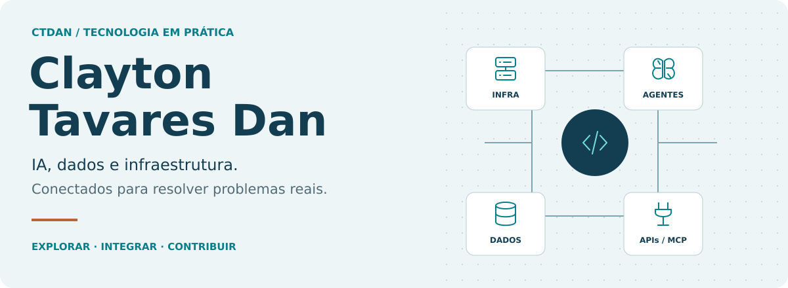
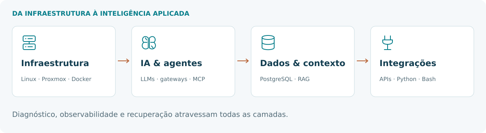

Gosto de entender o que acontece por trás das ferramentas — e de fazer peças diferentes trabalharem juntas. Entre servidores, agentes e código, meu foco é transformar tecnologia em algo útil, verificável e que eu consiga manter.

**Meu GitHub é uma bancada aberta:** projetos que exploro, adaptações que experimento e melhorias que devolvo ao open source.

[Contribuições](https://github.com/search?q=is%3Apr+author%3Aclaytontavaresdan&type=pullrequests) · [Repositórios](https://github.com/claytontavaresdan?tab=repositories) · [Relatos técnicos](https://github.com/search?q=is%3Aissue+author%3Aclaytontavaresdan&type=issues)

## O que conecto



- **Infraestrutura própria:** Linux, Proxmox VE, Docker e Tailscale. Serviços self-hosted, acesso remoto com MeshCentral, backups e recuperação.
- **IA além do chat:** LLMs, agentes, Hermes Agent, MCP e gateways. Integração de ferramentas, compatibilidade entre APIs, streaming e comportamento de fallback.
- **Dados que viram contexto:** PostgreSQL, busca semântica e RAG sobre documentação e históricos de atendimento. Reutilizar conhecimento para não investigar tudo do zero.
- **Automação com propósito:** Python, Bash e APIs conectando rotinas e sistemas. Do suporte a PDVs Linux à investigação de falhas em integrações de IA.

## Do uso à contribuição

<table>
<tr>
<td width="50%" valign="top">

### 🇧🇷 CloudCLI em português

Contribuí com o suporte ao **português brasileiro**. Uma ferramenta que uso, mais acessível para quem fala nossa língua.

**Incorporado ao projeto** · [PR #1518](https://github.com/siteboon/claudecodeui/pull/1518)

</td>
<td width="50%" valign="top">

### 🔀 9Router: investigar e corrigir

Propostas para tratar **streams interrompidos** e **modelos órfãos** após excluir um provedor.

**Estado atual nos links** · [PR #4871](https://github.com/decolua/9router/pull/4871) · [PR #4927](https://github.com/decolua/9router/pull/4927)

</td>
</tr>
</table>

## Base acadêmica, aplicação diária


<details>
<summary>Títulos das especializações</summary>

Pós-graduações lato sensu pela **FACUMINAS**, concluídas em **2025**:

- Inteligência Artificial.
- Banco de Dados.
- Big Data e Cloud Computing.
- Cybersecurity: Detecção de Ameaças e Proteção de Sistemas de Informática e Comunicações.

</details>

## A lógica por trás da bancada

```text
problema real
    |
    +-- entender o contexto
    +-- investigar e reproduzir
    +-- integrar ou corrigir
    +-- testar o resultado
    '-- documentar o que fica
```

> Uma resposta HTTP 200 não encerra a investigação. O resultado precisa funcionar.

---

**Sobre os forks:** estudo, adaptação e contribuição. Autoria dos projetos preservada; meu trabalho aparece nos commits e pull requests.
